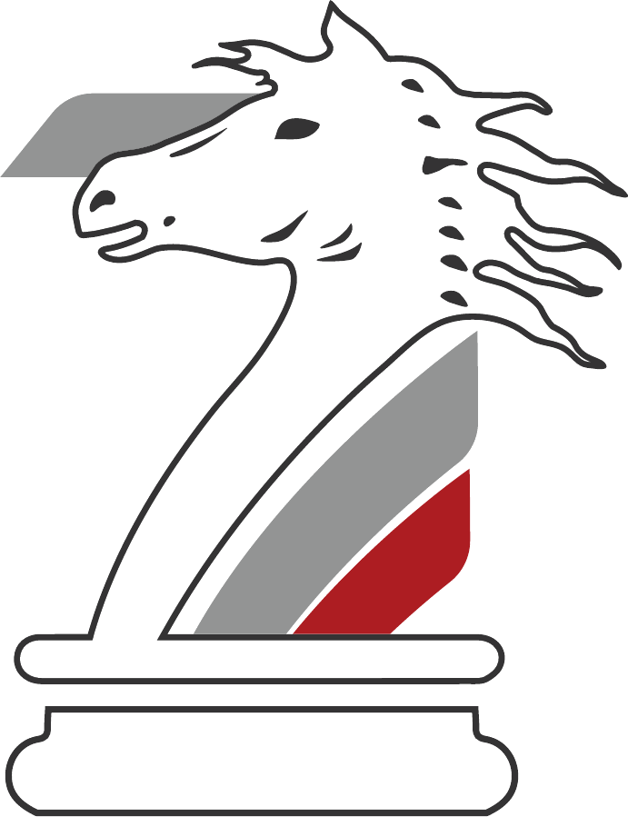

# Seven Motors — Luxury & Supercar Service Center, Riyadh

<p align="center">
  
</p>

<p align="center">
  <strong>Official web application frontend for Seven Motors (<a href="https://7-motors.com">7-motors.com</a>)</strong><br />
  Riyadh's premier specialist service, tuning, and diagnostic center for Ferrari, Lamborghini, McLaren, Porsche, Bentley, and the world's most elite performance machines.
</p>

<p align="center">
  
  
  
  
  
</p>

---

## Key Highlights & Focus Areas

### 1. Dual-Language & Complete RTL Engine (`EN` / `AR`)
* **Instant Direction Synchronization**: Dynamic switching between English (`ltr`) and Arabic (`rtl`) with zero layout shift or hydration jumps.
* **Luxury Arabic Typography**: Fully integrated with **IBM Plex Sans Arabic** and **Cairo** typography, tuned with zero letter-spacing leakage to preserve Arabic cursive ligatures.
* **Logical Component Alignment**: Complete bidirectional support across Search Dialog, Select Dropdowns, Context Menus, and Mobile Navigation Sheets.
* **Search Dialog Collision Prevention**: Strict logical positioning separating the search magnifying icon on the start side (`ps-3`) from the close `X` button on the end side (`left: 1rem` in RTL, `right: 1rem` in LTR).

### 2. CAiR Turbo Cinematic Theme Engine
* **Circular Ripple View Transitions**: Implemented using the native Web View Transitions API. Tracks the exact `(x, y)` click origin to trigger an expanding radial mask across the viewport.
* **Harmonized Icon Morphing**: Custom Sun/Moon cross-rotation with spring easing (`cubic-bezier(0.16, 1, 0.3, 1)`).
* **Brand-Aligned Palette**: Replaced generic yellow/blue accents with Seven Motors' signature **Carmine Crimson** (`oklch(52.5% 0.205 25)`) and **Titanium Platinum** tones.

### 3. Custom Arrow-Free Scrollbar Engine
* **Universal Arrow Suppression**: Completely removes default Windows/WebKit top and bottom scrollbar arrow buttons across all Chromium browsers (Chrome, Edge, Brave, Opera).
* **Luxury Automotive Finish**:
  * **Track**: Seamless transparent groove blending into the obsidian carbon backdrop.
  * **Thumb**: Smoky titanium glass pill (`rgba(255, 255, 255, 0.16)`) with `border-radius: 9999px`.
  * **Hover Glow**: Illuminates in signature Seven Motors Racing Crimson on mouse interaction.
* **Firefox Parity**: Dedicated CSS standards fallback via `@supports not selector(::-webkit-scrollbar)`.

### 4. Vector Squircle Favicon & Brand Identity
* **Multi-Resolution Monogram**: High-DPI squircle vector icon (`public/favicon.svg`) featuring a 10-degree carbon gradient, precision beveled rim, and 7M monogram.
* **Full Multi-Resolution ICO Bundle**: Embedded 16x16, 32x32, and 48x48 pixel anti-aliased bitmaps inside `public/favicon.ico`.

---

## Technology Stack

| Layer | Technology | Description |
|-------|------------|-------------|
| **Core Framework** | [React 19](https://react.dev) | Modern concurrent React architecture |
| **Routing & SSR** | [TanStack Router](https://tanstack.com/router) + TanStack Start | Full type-safe file-based routing with SSR |
| **Styling** | [Tailwind CSS v4](https://tailwindcss.com) + OKLCH | High-dynamic-range color gamut and CSS variable theming |
| **UI Primitives** | [Radix UI](https://www.radix-ui.com) + [shadcn/ui](https://ui.shadcn.com) | WAI-ARIA accessible interactive components |
| **Animations** | Motion + CSS View Transitions | Silky 60fps micro-interactions and transitions |
| **Icons** | [Lucide React](https://lucide.dev) | High-definition vector icons |
| **Build & Bundle** | [Vite 8](https://vite.dev) + [Nitro](https://nitro.unjs.io) | Lightning-fast development & production compilation |

---

## Project Structure

```text
├── public/
│   ├── favicon.svg              # Vector squircle monogram icon
│   ├── favicon.ico              # Multi-res bundled Windows favicon (16/32/48)
│   ├── images/                  # Official 7 Motors supercar photography & logos
│   └── fonts/                   # Typography assets
├── src/
│   ├── routes/                  # File-based routes (SSR)
│   │   ├── __root.tsx           # Document root, SEO meta, theme & lang hydration
│   │   ├── index.tsx            # Home page with supercar showcases & CTAs
│   │   ├── services.tsx         # Comprehensive maintenance & tuning catalogue
│   │   ├── facility.tsx         # Workshop, diagnostic bays & equipment
│   │   ├── about.tsx            # Company vision, master technicians & story
│   │   └── contact.tsx          # Booking system & direct Riyadh contacts
│   ├── components/
│   │   ├── site/                # Header, Footer, ThemeToggle, LanguageToggle, SearchDialog
│   │   ├── home/                # HeroSection, ServicesPreview, FacilityPreview, Reviews
│   │   └── ui/                  # Accessible UI primitives (dialog, command, sheet, select, …)
│   ├── lib/
│   │   ├── language.tsx         # Bilingual context (EN/AR), dictionary & RTL sync
│   │   ├── site.ts              # Business metadata, Riyadh coordinates & working hours
│   │   └── utils.ts             # Class merging & utility functions
│   └── styles.css               # Core design tokens, scrollbar engine & typography
└── vite.config.ts               # Vite & Nitro SSR configuration
```

---

## Getting Started

### Prerequisites
* **Node.js**: v20 or newer
* **npm** or **bun**

### Installation

```bash
# Clone the repository
git clone https://github.com/Apptunix-solutions/7-Motors-F.git

# Enter project directory
cd 7-Motors-F

# Install dependencies
npm install
```

### Development Server

```bash
npm run dev
```
Open [http://localhost:8080](http://localhost:8080) to view the application.

### Production Build

```bash
# Build client and Nitro SSR bundles
npm run build

# Preview production build locally
npm run preview
```

---

## Code Quality & Verification

```bash
# Run ESLint validation
npm run lint

# Format code with Prettier
npm run format
```

---

## License

Private repository. All rights reserved by **Seven Motors Riyadh** and **Apptunix Solutions**.
